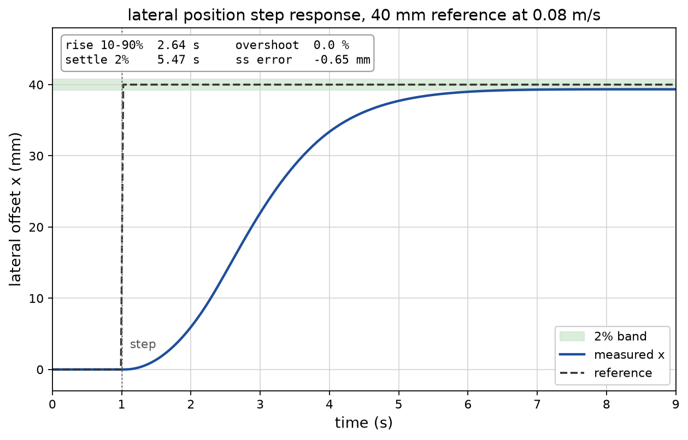
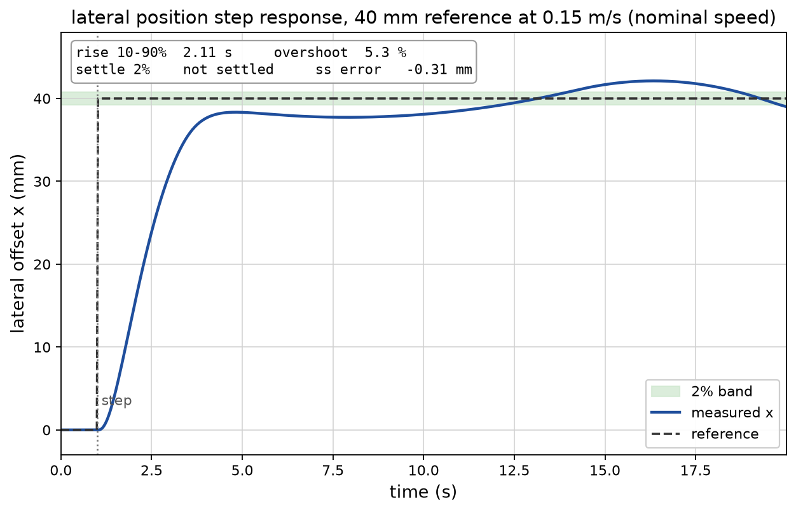
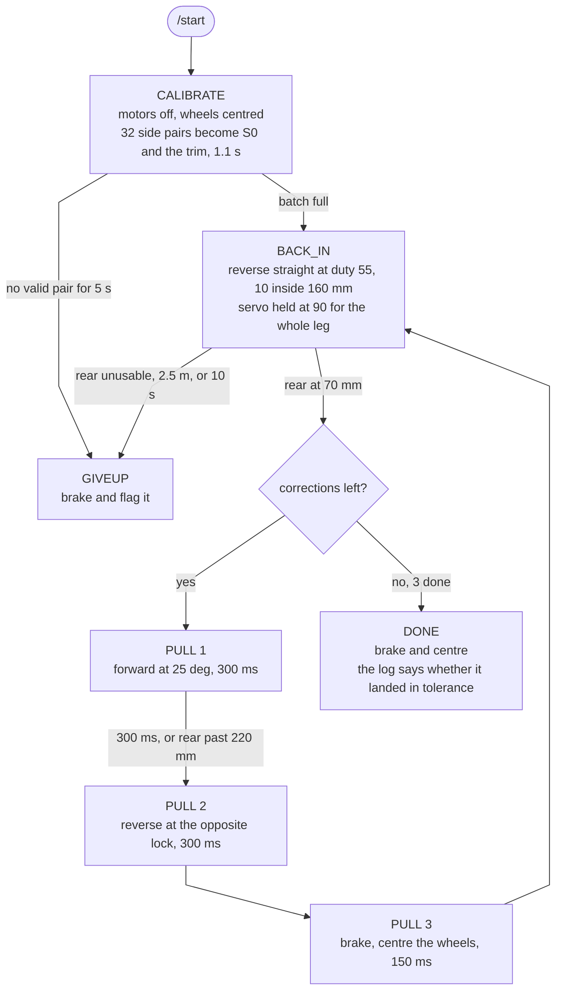

# Self-parking-car

A small RC car reverses into a perpendicular parking bay, lines itself up with the bay walls and stops before the rear obstacle. The steering is closed loop, the step response is logged by a host rig, and a web dashboard shows the live state and a graph.

The car uses VL53L0X time-of-flight sensors for autonomous reverse parking. The steering is described as Ackermann, and the control code runs either kind of steering until someone measures the chassis.

## The hardware

| part | spec | notes |
|---|---|---|
| MCU | ESP32-S3 Super Mini | 4MB flash, 240MHz dual core, native USB-C, module soldered to the board |
| ToF sensors | 3x VL53L0X | must be VL53L0X, not VL53L1X. they are not drop-in compatible and use a different library. two face out sideways, one faces back |
| steering servo | SG90 or MG996R | the MG996R has less backlash, which matters here |
| motor driver | DRV8833 module | a TB6612FNG also works and gives a clean sleep between runs |
| drive motor | stock Tamiya yellow motor, 6V rated | |
| chassis | Tamiya RC chassis with servo bay | the stock knuckle is turned by the drive motor through a plastic arm, so it cannot take a commanded angle and the chassis is converted to servo steering |
| power | one 5 V rail for the whole car | the ESP32, the DRV8833 VM pin and the servo share it. The stock 6 V motor sees about 4.5 V at the driver's dropout, so the reverse duty has to be high enough for it to break away from rest. The DRV8833 is rated to 10.8 V, so VM must never be fed from a 3S pack directly |

The three sensors are addressed over one I2C bus. Each one is enabled in turn through its XSHUT line and given an address: `0x29` left, `0x2A` right, `0x2B` rear.

### Pin map

| GPIO | function |
|---|---|
| 1 | VL53L0X left XSHUT |
| 2 | VL53L0X right XSHUT |
| 6 | DRV8833 IN3 (right motor) |
| 7 | DRV8833 IN4 (right motor) |
| 4 | DRV8833 IN1 (left motor) |
| 5 | DRV8833 IN2 (left motor) |
| 8 | I2C SDA |
| 9 | I2C SCL |
| 10 | VL53L0X rear XSHUT |
| 11 | steering servo signal, 50Hz, 1000 to 2000µs |

The table is the harness as it stands. Every pin in it, the two inversion flags, the three sensor addresses and the sensor timing live in `control/config.h` under `namespace board`, so a measured change touches one file.

Leave GPIO 26 to 32 alone: the in-package flash claims them. GPIO 19 and 20 are the USB pins, GPIO 43 and 44 are UART0, and GPIO 0, 3, 45 and 46 are strapping pins that are sampled at boot. GPIO 9, 10 and 11 are FSPI IO MUX pins, safe here only because nothing on this board drives SPI2.

## Instructions

### 1. The toolchain

```bash
python3 -m venv --without-pip .venv
curl -fsSL https://bootstrap.pypa.io/get-pip.py -o /tmp/get-pip.py
.venv/bin/python3 /tmp/get-pip.py
.venv/bin/pio run
```

The first build pulls the pinned platform and the toolchain, about 4GB and a few minutes. After that a build takes seconds. Each machine needs its own `~/.platformio`, because it lives under `$HOME`.

If `pio` stops before it compiles anything with

```
Error: Failed to install Python dependencies into penv
```

Then PlatformIO's own environment needs pip:

```bash
curl -fsSL https://bootstrap.pypa.io/get-pip.py -o /tmp/get-pip.py
~/.platformio/penv/bin/python3 /tmp/get-pip.py
```

### 2. The firmware

```bash
.venv/bin/pio run            # build
.venv/bin/pio run -t upload  # flash it, with the board connected
```

#### Flash a prebuilt binary

Tagged builds carry a ready-to-flash image at
`https://github.com/AndrewKHalim/Self-Parking-Car/releases`, named
`autoparking.factory.bin`. The same file sits in the tagged tree under
`releases/`.

Put the board in download mode: hold **BOOT**, tap **RESET**, release
**BOOT**. It then enumerates as `/dev/ttyACM0` on Linux, `/dev/cu.usbmodem*` on
macOS or `COMx` on Windows.

```bash
~/.platformio/penv/bin/esptool.py --chip esp32s3 --port /dev/ttyACM0 \
    --baud 460800 write_flash 0x0 autoparking.factory.bin
```

`autoparking.factory.bin` is the bootloader, the partition table, the boot app
and the application merged into one image, so it goes at `0x0` and nothing else
is needed. Do not flash `firmware.bin` at `0x0`: that is the application alone
and belongs at `0x10000`.

The four separate images work too, if they are what you have:

```bash
~/.platformio/penv/bin/esptool.py --chip esp32s3 --port /dev/ttyACM0 \
    --baud 460800 write_flash 0x0 bootloader.bin \
    0x8000 partitions.bin 0xe000 boot_app0.bin 0x10000 firmware.bin
```

Check the write with `verify_flash 0x0 autoparking.factory.bin` in place of
`write_flash`, or open the USB CDC console at 115200 and watch for the
`autoparking-car: boot` line. After the reset the board takes about 15 s to
give up on the configured network before its access point appears; see the next
section.

`lib/Network/src` is committed source with a hand-written `library.json` beside it, because Arduino core 3.3.12 ships `Network` without one and PlatformIO will not link it. Leave it as it is: a symlink into `~/.platformio/packages/` resolves on the machine that made it and nowhere else.

#### Bench drive test

`bench/` is a separate PlatformIO project, so it does not touch the parking firmware, its environment or its config. It has no sensors, no servo and no radio: it drives both motors forward at duty 200 the moment the board is powered and keeps driving until the power is cut, which is what to flash when the question is only whether the drive works. The pin map and the two inversion flags still come from `control/config.h`, so a rewiring carries over.

```bash
cd bench
../.venv/bin/pio run                    # -> .pio/build/motor_test/firmware.factory.bin
../.venv/bin/pio run -t upload          # or flash it with esptool as in section 2
```

If the car pulls away backwards, the inversion flag for that side is wrong. If it does not move at all, the fault is in the motor wiring, the driver's power or its VM rail, and not the parking logic.

The project also builds a continuous servo test, `env:servo_test`, which holds the steering servo at centre for a second, then sweeps from 45 to 135 degrees and back, 5 degrees every 400 ms, until the power is cut. It prints each angle with the pulse it sends and whether the command is increasing or decreasing, and deliberately not which way the wheels point, because the linkage is mirrored in a way nobody has measured. The two ends are `main`'s clamped range, and the source says where to widen them.

```bash
cd bench
../.venv/bin/pio run -e servo_test
```

The prebuilt image is `releases/servo_test.factory.bin`, flashed at `0x0` exactly as the parking image is.

The same project builds an I2C scan, which is what to flash when the sensors do not answer:

```bash
cd bench
../.venv/bin/pio run -e i2c_scan
```

It drives the three XSHUT lines high, prints the idle voltage of GPIO 8 and 9 read on the ADC, then scans with SDA on GPIO 8 and SCL on GPIO 9, closes the bus, prints the levels again, and rescans with the two swapped. A device at `0x29` with the pins as wired and nothing when swapped means the bus is healthy and the wiring is right. The other way round means the two lines are crossed. Nothing in either scan means no sensor is powered or out of reset, which is a different fault from a crossed bus. On the levels, a line near 0 mV is held low, a few hundred is floating with no pull-up, and 3300 or more is a live pull-up, a 5 V rail included.

### 3. The network and the dashboard

The firmware joins the network named in `src/wifi_config.h`: put the SSID and the password there, or leave the placeholders and let it fall back. The join is bounded at 15 s, after which the car brings up its own access point:

| SSID| password | page |
|---|---|---|
| `autoparking` | `autoparking` | `http://192.168.4.1/` |

The page shows the live state and a chart of the last 1200 samples, and the button asks the control task to start a run. The readout cells are t, x, psi, the left and right side gaps, the rear gap, the servo command, the phase, the correction count and the calibration flag. The chart carries three labelled series against time in seconds, x in mm, psi in degrees and the servo in degrees, each on a fixed axis. The page seeds itself from `/log.csv` on load and on every reconnect, so a reload does not lose the run, and the board holds 34 s of it. Telemetry goes to the page over a WebSocket at `/ws`, about ten messages a second.

### 4. The host simulator

Removed with the steering core on 2026-11-02. The commands below are kept as a record. `tools/sim_main.cpp` still includes `control/control.h` and `control/ackermann.h`, which no longer exist, so neither it nor `tools/step_rig.cpp` builds against this tree. `tools/geom_checks.cpp` covers the geometry that is still here, and `control/config.h` is unchanged in the parts it checks, but the owner has the car now and the host simulator is not part of the build.

```bash
mkdir -p build
g++ -std=c++17 -O2 -Wall -Wextra -Icontrol -o build/sim tools/sim_main.cpp -lm
g++ -std=c++17 -O2 -Wall -Wextra -Icontrol -o build/geom_checks tools/geom_checks.cpp -lm

./build/geom_checks                             # the sensor geometry
./build/sim --x 0.04 --psi 5 --trace            # one scenario, traced
./build/sim --x 0.04 --psi 5 --steer ackermann  # the other steering model
python3 tools/sweep.py --out build/sweep.csv    # the parameter sweep
```

## The step response

This section records the cascade that was removed on 2026-11-02. The firmware no longer contains `Control::step`, so the rig and the figures below describe a design that is no longer on the car. They are kept because the numbers are the reason the fixed-time maneuver replaced it: a loop tuned for 0.15 m/s turned a few millimetres of gap noise into tens of degrees of servo.

The controlled variable was the rear axle lateral offset `x`, the state the parking supervisor regulated. `tools/step_rig.cpp` steps the reference from 0 to 40 mm while the car reverses at a constant speed, through the real `Control::step` and the same servo and bicycle model the simulator uses. One sample per 30 Hz control tick, and the figures come from that CSV.





The 0.08 m/s run is the settling case. The 2 percent band is 0.80 mm around the 40 mm reference. At the nominal 0.15 m/s the dead zone from the 1.8 degree servo dead band is 2.35 mm, wider than that band, so the position limit-cycles between about 37.7 and 42.1 mm and does not settle.

| metric | 0.08 m/s | 0.15 m/s |
|---|---|---|
| rise time, 10 to 90 % | 2.64 s | 2.11 s |
| overshoot | 0.00 % | 5.30 % |
| settling, 2 % band | 5.47 s | not settled |
| steady-state error, last 1 s | -0.65 mm (-1.61 %) | -0.31 mm (-0.79 %) |
| peak steering command | 24.98 deg | 24.98 deg |
| peak heading | 12.68 deg | 7.97 deg |

What the numbers assume:

- Simulation, not hardware. Nothing here is a measurement.
- The rig measures `x` directly. It has no ToF geometry, cone, range failures, sensor latency, walls or clearance cap, and no parking supervisor in the loop.
- The servo numbers are the SG90 datasheet figures already in `Config`: 600 deg/s at no load (0.10 s per 60 degrees at 4.8 V), and a 1.8 degree dead band mapped through the 1000 to 2000 us position table.
- The servo model is dead band plus slew only: no load, no backlash, no compliance, no position feedback.
- The figures use the default parallel steering and the 25 degree mechanical limit. Ackermann would clamp to `deltaEqMax`, about 20 degrees.
- Constant speed. The drive ramp is not modelled, because `accel` is a simulator field and not a `Config` value, so the car starts at the configured speed.
- The speed is commanded constant, but the parallel scrub term bleeds it over the run, -0.080 to -0.07795 m/s and -0.150 to -0.14862 m/s. The controller is fed the nominal speed.
- No measurement noise. The seed is fixed at 1, and `--noise` adds Gaussian noise on `x` for a repeatable noisy run.
- 30 Hz control, with the plant substepped at 1 ms.
- The integral gain is zero (`ki = 0`), so there is no integral action to trim the offset the dead band leaves. The measured residual is 1.61 percent at 0.08 m/s and 0.79 percent at 0.15 m/s.
- The run starts at `x = 0`, the parking target, in free space with psi and delta at zero, and the step lands at 1.0 s.

Reproduce both runs and the plots:

```bash
mkdir -p build docs
g++ -std=c++17 -O2 -Wall -Wextra -Icontrol -o build/step_rig tools/step_rig.cpp -lm

./build/step_rig --speed 0.08 --ref 0.04 --duration 15
.venv-plot/bin/python tools/step_plot.py

./build/step_rig --speed 0.15 --ref 0.04 --duration 20 \
    --out docs/nominal_step_response.csv \
    --servo-out build/nominal_servo.csv \
    --info-out build/nominal_run_info.txt
.venv-plot/bin/python tools/step_plot.py \
    --csv docs/nominal_step_response.csv \
    --info build/nominal_run_info.txt \
    --suffix _015 --note "nominal speed" --window 19
```

The plot script needs matplotlib in a throwaway venv. This is not the repo venv, and `.venv-plot/` is ignored:

```bash
python3 -m venv .venv-plot
.venv-plot/bin/pip install -r tools/plot-requirements.txt
```

The SVG versions of the figures sit beside the PNGs. The longer note, with the plant, the reference hook and the assumptions, is [docs/step-response.md](docs/step-response.md).

## The dashboard and the web server

| file | what is in it |
|---|---|
| `src/main.cpp` | the runtime: the two FreeRTOS tasks and the handoff between them |
| `src/esp32_hal.h` | the ESP32 `Hal`: three VL53L0X on one bus, the servo and the DRV8833 |
| `src/dashboard_html.h` | the page, as one PROGMEM string |
| `src/telemetry_ring.h` | the 1024-record spinlocked run log |
| `src/wifi_config.h` | the SSID, the password, the fallback access point and the hostname |

The core map:

| what runs | core | where it is set |
|---|---|---|
| control task | 1 | `xTaskCreatePinnedToCore`, priority 5, 8 KB in `src/main.cpp`, 33 ms from `control/config.h` |
| web task | 0 | `xTaskCreatePinnedToCore`, priority 2, 8 KB in `src/main.cpp`, 100 ms from `control/config.h` |
| AsyncTCP task | 0 | `CONFIG_ASYNC_TCP_RUNNING_CORE=0` in `platformio.ini` |
| WiFi and lwIP tasks | 0 | the platform's sdkconfig: `CONFIG_ESP_WIFI_TASK_PINNED_TO_CORE_0` and `CONFIG_LWIP_TCPIP_TASK_AFFINITY=0x0` |

The endpoints:

| route | method | what it does |
|---|---|---|
| `/` | GET | the page |
| `/ws` | WebSocket | telemetry, one JSON object per message |
| `/start` | GET | sets the start request |
| `/log.csv` | GET | the held run as fixed-width CSV, `text/csv` attachment |

The page is reachable on the configured network, or over the `autoparking` access point at `192.168.4.1`. The SSID, the password and the fallback are in `src/wifi_config.h`.

Telemetry crosses from the control task to the web task through a one-deep queue written with `xQueueOverwrite`, so a slow socket can never hold up the control loop: the web task either gets the newest tick or nothing at all. The JSON carries the numeric fields as integers, t in ms, distances in mm, angles in milliradians and the servo in whole degrees. Phase is a string, and the stroke field is always "none" until a maneuver uses it again. The web task drains the queue every 100 ms and sends, which is 10 Hz. The start request crosses the other way as a `std::atomic<bool>`, set by `/start` and cleared by the control task, which ignores it mid-run and retakes the calibration on every accepted request.

The control task also prints one line at 10 Hz while it runs, every third tick: the phase and a fixed NONE in the stroke column, then x, psi, rear, gL and gR, the servo command, cal, ok and the correction count. So a bench check does not need a phone joined to the access point.

This runs on the car. The board boots the parking image, reports over USB and serves the page, and the page streams a live `psi`, which is computed from the two side sensors, so both of them return ranges. The bench image drives the motor legs at duty 200 on the 5 V rail. The steering is not calibrated: the servo centre, its direction and the 2.9 to 1 linkage ratio are assumptions from the CAD, so the wheels do not reach the commanded angle and no maneuver has been run to completion. The rear channel has not been read out on its own, and the page has not been opened on a phone.

## How the maneuver runs

The maneuver is fixed. Every segment is a constant held for a measured time, because a computed profile needs a measured car to be right and this car is not measured yet. The firmware closes no steering loop at all. The pose is still computed for the dashboard, and no motor or servo decision reads it.



The reverse is a straight leg, so the front wheels stay still until the rear reading says the car is at the wall. That is what the car looked like it needed: the old cascade steered from the first tick on an assumed speed, and the noise was enough to swing the servo before the car moved.

The correction is main's shape. One forward pulse at a fixed lock, then the same lock the other way in reverse, which is the S-curve the return leg needs, then a short brake and centre. The direction comes from the sign of `gL - gR`, compared the way main compared it, and `pull_steer_sign` in `control/config.h` is the one polarity to flip if the car corrects the wrong way on the car.

The rear sensor is the only measurement that can end a leg early. A reading under 160 mm drops the reverse to the crawl duty, and a reading past 220 mm ends the forward pulse, which is main's gate. Everything else runs on its clock.

## What the sensing is for now

The state is still referred to the rear axle centre, and `control/geometry.h` still turns the two side gaps into `x` and `psi` against the calibrated `S0` and the trim. The dashboard plots both. Nothing else reads them: the firmware has no steering law, so the pose is telemetry and the maneuver runs on the rear reading and the clock. `control/hal.h` is still the one interface, so `src/esp32_hal.h` is the only hardware-aware code.

## The layout

| path | what is in it |
|---|---|
| `control/` | the control core: geometry, the supervisor and the `Hal` interface. no hardware calls |
| `control/config.h` | every tunable, in one place: the chassis geometry, the maneuver, the pins, and the sensor and task timing. the one file to edit after measuring |
| `control/supervisor.h` | the phase supervisor: calibrate, reverse, pull, done |
| `control/geometry.h` | the two side gaps to `x` and `psi`, for the dashboard only |
| `tools/sim_main.cpp` | the host plant, the sensor forward model, the scenarios and the fault injection. it targets the removed steering core, so it no longer builds against this tree |
| `tools/step_rig.cpp` | the lateral step-response rig, written against the removed `Control` |
| `tools/step_plot.py` | computes the step metrics, writes the step figures |
| `tools/sweep.py` | the parameter sweep, written against the removed steering core |
| `tools/geom_checks.cpp` | direct checks of the sensor geometry |
| `docs/` | the step-response note, both time series and the PNG and SVG figures |
| `src/main.cpp` | the firmware runtime: the control task on core 1, the web task on core 0, and the handoff between them |
| `src/esp32_hal.h` | the ESP32 `Hal`: three VL53L0X on one bus, the servo and the DRV8833 |
| `src/dashboard_html.h` | the dashboard, as one PROGMEM string |
| `src/telemetry_ring.h` | the 1024-record spinlocked run log behind `/log.csv` |
| `src/wifi_config.h` | the SSID, the password and the fallback access point, in one place |
| `src/control_build.cpp` | builds the control core with no hardware attached, as a compile check |
| `lib/Network/` | the committed `Network` source, with the manifest that makes PlatformIO build it |

The control core has no hardware calls in it, so the same code runs against the ESP32 through `src/esp32_hal.h`. The firmware is the only build that matters now. The host tools were written against the steering core that was removed on 2026-11-02, so they no longer compile and are kept only as a record until the owner decides what to do with them.

## Status

The firmware builds and links for the ESP32-S3 Super Mini at 24.7 percent of RAM (80,924 of 327,680 bytes) and 1,043,534 bytes of the 4,063,232-byte `app0`. The fixed-time maneuver is new on 2026-11-02 and has not been flashed or run on the car, so nothing here claims how it drives. The working tree holds an uncommitted `releases/autoparking.factory.bin` of 1,125,504 bytes. The last published image is `hw-2026-11-02.4`, 1,133,168 bytes, which still carries the removed cascade. The servo centre, its direction and the 2.9 to 1 linkage ratio are still unmeasured assumptions, and the wheels are now clamped to the 45 to 135 degrees main drove.
