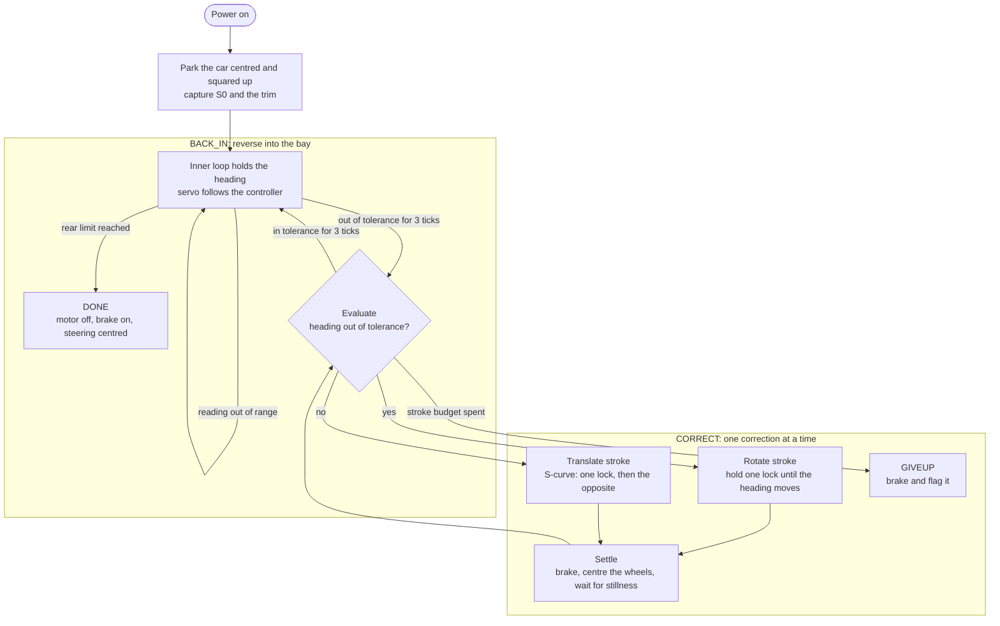
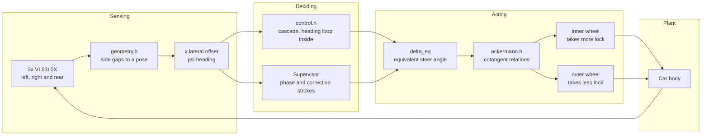

# Self-Parking-Car

A small RC car reverses into a perpendicular parking bay, lines itself up with
the bay walls, and stops before the rear obstacle. Steering is closed loop. A
web dashboard plots the step response.

Prototype of a car with Ackermann steering, using VL53L0X time-of-flight
sensors for autonomous reverse parking.

## How the manoeuvre runs

The supervisor owns the manoeuvre and the inner loop owns the steering. They
never fight over the servo: during a correction stroke the supervisor has it,
and otherwise the inner loop does.

The heading is corrected before the offset, because a standing heading error
makes the offset grow. A translate stroke is an S-curve rather than one held
angle: the servo takes one lock for the first half and the opposite lock for
the second half, so the heading excursion cancels itself and the car ends up
moved sideways with its heading where it started. The stroke stops on the
measured excursion rather than on a timer, which is what makes it independent
of the speed and of the battery.

## How the sensing and steering fit together

The state is referred to the rear axle centre, which is where the instant
centre of rotation of an Ackermann vehicle lives. That is what lets one
equivalent steer angle describe the whole vehicle.

The controller works in one angle, `delta_eq`, and `ackermann.h` splits it
across the two front wheels. The bicycle model in the simulator is exact for
true Ackermann rather than an approximation, because the rear wheels are fixed
and the whole vehicle state is already referenced to the rear axle centre.

## Where to look

| File | What is in it |
|---|---|
| `PLAN.md` | The full design: hardware, control system, geometry, simulation plan, open items |
| `AUDIT.md` | The control logic audit of 2026-10-21, the findings, and what was done about each of them |
| `HANDOFF.md` | The per-turn work log. Read this first when picking the work up |
| `INFO.md` | Operational notes: verified commands, pin map, pitfalls, current status |
| `OVERVIEW.md` | A shareable version of the design for a teammate |
| `REVIEW-BRIEF.md` | The brief that went out for external review of the control architecture |
| `REVIEW.md` | That review, and the corrections folded back into `PLAN.md` |
| `control/` | The control core. No hardware calls, only the `Hal` interface |
| `tools/sim_main.cpp` | The host plant, the sensor forward model, the scenarios |
| `tools/sweep.py` | The parameter sweep, writes CSV and prints a summary |
| `tools/geom_checks.cpp` | Direct checks of the sensor geometry, including the clearance interlock |

The same `control/` code compiles against the real ESP32 HAL and against the
host simulator, so the analysis can never drift from the firmware.

## Status

The firmware builds and links. The board has never been flashed, and no sensor
reading has been verified on real hardware. The control core and the host
simulator are written and the sweep runs; the firmware HAL adapter and the
dashboard are not written yet.
