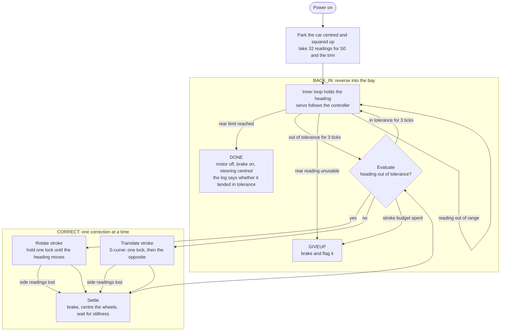
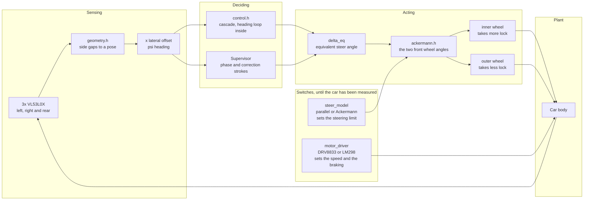

# Self-Parking-Car

A small RC car reverses into a perpendicular parking bay, lines itself up with
the bay walls, and stops before the rear obstacle. Steering is closed loop, and
a web dashboard plots the step response.

The car uses VL53L0X time-of-flight sensors for autonomous reverse parking.
Its steering is described as Ackermann, and the control code runs either kind
of steering until someone measures the chassis.

## The hardware

| Part | Spec | Notes |
|---|---|---|
| MCU | ESP32-S3-DevkitC-1 N16R8 | 16MB flash, 8MB octal PSRAM, dual core at 240MHz |
| ToF sensors | 3x VL53L0X | Must be VL53L0X, not VL53L1X. They are not drop-in compatible and use a different library. Two face out sideways, one faces back |
| Steering servo | SG90 or MG996R | MG996R has less backlash, which matters here |
| Motor driver | DRV8833 module | TB6612FNG also works and gives a clean sleep between runs |
| Drive motor | Stock Tamiya yellow motor, 6V rated | |
| Chassis | Tamiya RC chassis with servo bay | The stock knuckle is turned by the drive motor through a plastic arm, so it cannot take a commanded angle and the chassis is converted to servo steering |
| Power | 2S LiPo plus buck converter | The motor rail needs 6V regulation |

The three sensors are addressed over one I2C bus. Each one is enabled in turn
through its XSHUT line and given its address: `0x29` left, `0x2A` right, `0x2B`
rear.

### Pin map

| GPIO | Function |
|---|---|
| 8 | I2C SDA |
| 9 | I2C SCL |
| 15 | VL53L0X left XSHUT |
| 16 | VL53L0X right XSHUT |
| 10 | VL53L0X rear XSHUT |
| 17 | Steering servo signal, 50Hz, 500 to 2500µs |
| 18 | DRV8833 IN1 |
| 21 | DRV8833 IN2 |

Leave GPIO 26 to 32 alone: the octal PSRAM claims them. GPIO 19 and 20 are the
USB pins, and GPIO 0, 3, 45 and 46 are strapping pins that are sampled at
boot.

## Building it

```bash
# the firmware
.venv/bin/pio run          # an incremental build takes a few seconds, a clean
                            # one takes about 13 minutes
.venv/bin/pio run -t upload # flash it, with the board connected

# the host simulator, which needs no PlatformIO
g++ -std=c++17 -O2 -Wall -Wextra -Icontrol -o build/sim tools/sim_main.cpp -lm
g++ -std=c++17 -O2 -Wall -Wextra -Icontrol -o build/geom_checks tools/geom_checks.cpp -lm

# the parameter sweep
python3 tools/sweep.py --out build/sweep.csv
```

Three things bite when the build runs on a fresh machine.

**PlatformIO's own environment has no pip.** The system Python has no
`ensurepip` on some distributions, and PlatformIO creates its own environment
under `~/.platformio/penv`. If the build fails before it compiles anything
with

```
Error: Failed to install Python dependencies into penv
Error: uv installation via pip failed with exit code 1
```

then that environment needs pip:

```bash
curl -fsSL https://bootstrap.pypa.io/get-pip.py -o /tmp/get-pip.py
~/.platformio/penv/bin/python3 /tmp/get-pip.py
```

The project's own `.venv` is made the same way, with
`python3 -m venv --without-pip` and then the same script.

**`lib/Network/src` is committed source, not a symlink.** Arduino core 3.3.12
ships `Network` with an Arduino IDE `library.properties` but no PlatformIO
`library.json`, so PlatformIO will not build or link it on its own. `WiFi`
then compiles against headers that resolve, and the link fails on undefined
`NetworkInterface` symbols without pointing at the real cause. The fix is the
committed copy in `lib/Network/src` with the hand-written `library.json` beside
it. A symlink into `~/.platformio/packages/` is not an alternative: it is an
absolute path into one machine's tree, and it resolves there and nowhere else.
When the platform pin moves, re-copy the framework's `Network/src` over
`lib/Network/src/`.

**Each user needs their own `~/.platformio`.** It lives under `$HOME`, so
another machine's home directory is not readable. That is normal, and the first
build downloads about 4GB of platform and toolchain before it settles into
seconds.

## How the manoeuvre runs

The supervisor owns the manoeuvre and the inner loop owns the steering. They
never fight over the servo: during a correction stroke the supervisor has it,
and otherwise the inner loop does.



The heading is corrected before the offset, because a standing heading error
makes the offset grow. A translate stroke is an S-curve rather than one held
angle: the servo takes one lock for the first half and the opposite lock for
the second half, so the heading excursion cancels itself and the car ends up
moved sideways with its heading where it started. The stroke stops on the
measured excursion rather than on a timer, which is what makes it independent
of the speed and of the battery.

A stroke that loses the side readings stops, because the car may be against a
wall and holding the lock makes that worse. The rear sensor gets the same
treatment: an unusable reading stops the car unless the wall is simply out of
the sensor's range, which the distance it has reversed since the last usable
reading tells apart.

## How the sensing and steering fit together

The state is referred to the rear axle centre, which is where the instant
centre of rotation lives on any car with a fixed rear axle. That is what lets
one equivalent steer angle describe the whole vehicle.



The controller works in one angle, `delta_eq`. The bicycle model in the
simulator is exact for it rather than an approximation, because the rear
wheels are fixed and the whole vehicle state is already referenced to the rear
axle centre.

Two things are switches rather than facts, because neither has been measured
yet. The steering model decides how much lock the car may be given: with
Ackermann steering the inner wheel reaches its stop before the equivalent
angle does, and the equivalent angle is held below that. The motor driver
decides the speed and the stopping distance: the DRV8833 and the LM298 have
the same truth table, so the firmware does not care which one is fitted, but
the LM298 drops several volts across itself and would run the car at about
two thirds of the speed.

## The layout

| Path | What is in it |
|---|---|
| `control/` | The control core: geometry, the steering loop, the supervisor and the stroke model. No hardware calls, only the `Hal` interface |
| `control/ackermann.h` | The Ackermann relations, splitting the equivalent angle into the two front wheel angles |
| `tools/sim_main.cpp` | The host plant, the sensor forward model, the scenarios and the fault injection |
| `tools/sweep.py` | The parameter sweep, writes a CSV and prints a summary |
| `tools/geom_checks.cpp` | Direct checks of the sensor geometry, including the clearance interlock |
| `src/main.cpp` | The firmware. A stack-verification sketch today, not the control firmware |
| `lib/Network/` | The committed `Network` source, with the manifest that makes PlatformIO build it |

The control core has no hardware calls in it, so the same code runs against
the host simulator and against the ESP32 once the HAL adapter is written.
Today only the simulator does.

## Status

The firmware builds and links. The board has never been flashed, and no sensor
reading has been verified on real hardware. The control core and the host
simulator are written and the sweep runs; the firmware HAL adapter and the
dashboard are not written yet.
