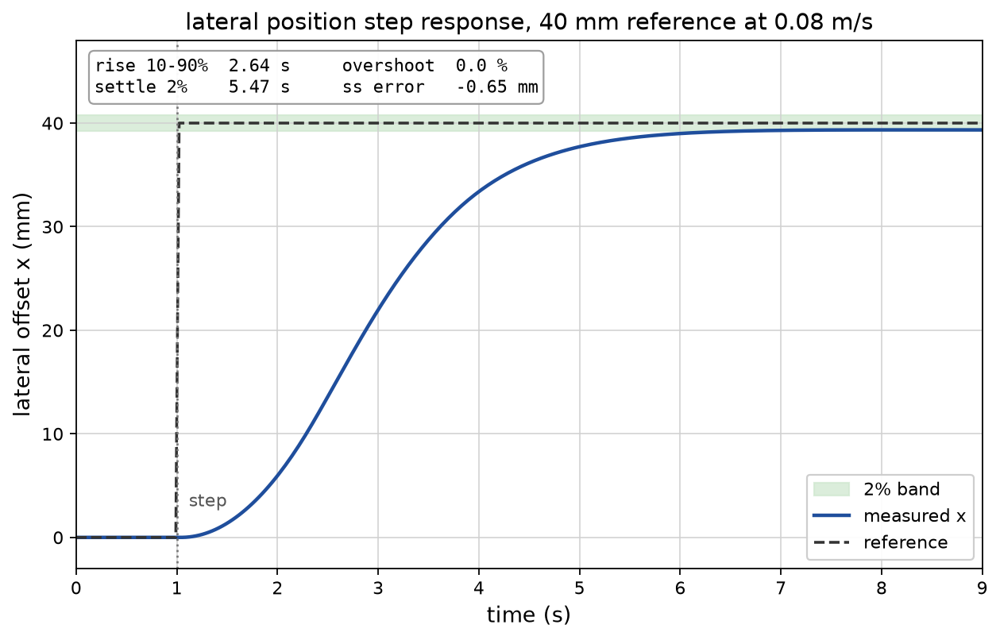
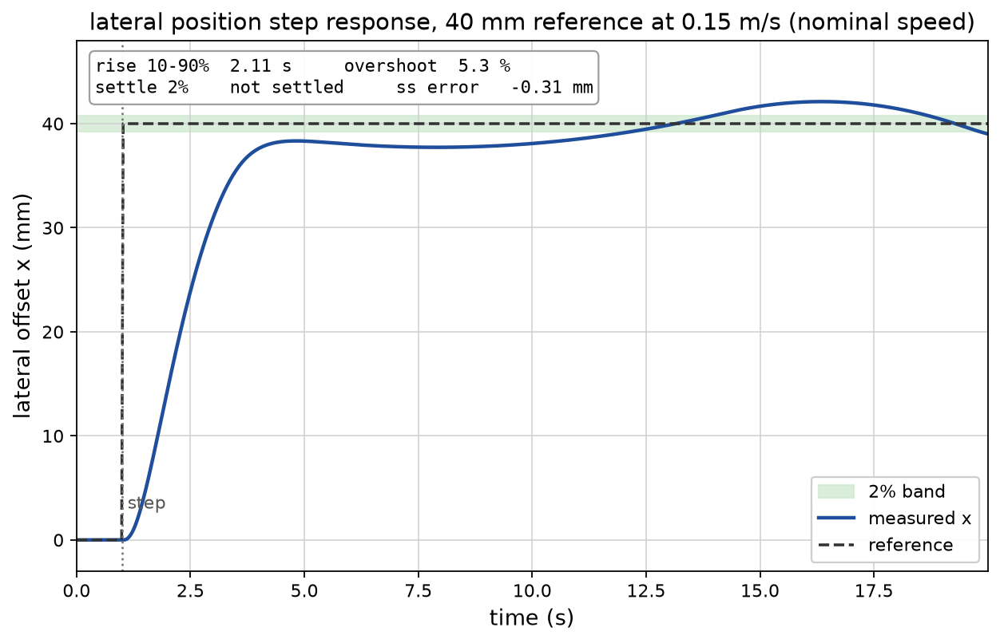
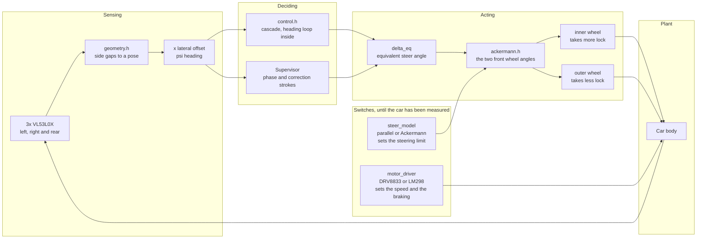

# self-parking-car

a small RC car reverses into a perpendicular parking bay, lines itself up with
the bay walls and stops before the rear obstacle. the steering is closed loop,
the step response is logged by a host rig, and a web dashboard shows the live
state and a graph.

the car uses VL53L0X time-of-flight sensors for autonomous reverse parking. the
steering is described as Ackermann, and the control code runs either kind of
steering until someone measures the chassis.

## the hardware

| part | spec | notes |
|---|---|---|
| MCU | ESP32-S3-DevkitC-1 N16R8 | 16MB flash, 8MB octal PSRAM, dual core at 240MHz |
| ToF sensors | 3x VL53L0X | must be VL53L0X, not VL53L1X. they are not drop-in compatible and use a different library. two face out sideways, one faces back |
| steering servo | SG90 or MG996R | the MG996R has less backlash, which matters here |
| motor driver | DRV8833 module | a TB6612FNG also works and gives a clean sleep between runs |
| drive motor | stock Tamiya yellow motor, 6V rated | |
| chassis | Tamiya RC chassis with servo bay | the stock knuckle is turned by the drive motor through a plastic arm, so it cannot take a commanded angle and the chassis is converted to servo steering |
| power | 2S LiPo plus buck converter | the motor rail needs 6V regulation |

the three sensors are addressed over one I2C bus. each one is enabled in turn
through its XSHUT line and given an address: `0x29` left, `0x2A` right, `0x2B`
rear.

### pin map

| GPIO | function |
|---|---|
| 8 | I2C SDA |
| 9 | I2C SCL |
| 15 | VL53L0X left XSHUT |
| 16 | VL53L0X right XSHUT |
| 10 | VL53L0X rear XSHUT |
| 17 | steering servo signal, 50Hz, 1000 to 2000µs |
| 18 | DRV8833 IN1 |
| 21 | DRV8833 IN2 |

leave GPIO 26 to 32 alone: the octal PSRAM claims them. GPIO 19 and 20 are the
USB pins, and GPIO 0, 3, 45 and 46 are strapping pins that are sampled at
boot.

## instructions

### 1. the toolchain

```bash
python3 -m venv --without-pip .venv
curl -fsSL https://bootstrap.pypa.io/get-pip.py -o /tmp/get-pip.py
.venv/bin/python3 /tmp/get-pip.py
.venv/bin/pio run
```

the first build pulls the pinned platform and the toolchain, about 4GB and a
few minutes. after that a build takes seconds. each user needs their own
`~/.platformio`, because it lives under `$HOME`.

if `pio` stops before it compiles anything with

```
Error: Failed to install Python dependencies into penv
```

then PlatformIO's own environment needs pip:

```bash
curl -fsSL https://bootstrap.pypa.io/get-pip.py -o /tmp/get-pip.py
~/.platformio/penv/bin/python3 /tmp/get-pip.py
```

### 2. the firmware

```bash
.venv/bin/pio run            # build
.venv/bin/pio run -t upload  # flash it, with the board connected
```

`lib/Network/src` is committed source with a hand-written `library.json`
beside it, because Arduino core 3.3.12 ships `Network` without one and
PlatformIO will not link it. leave it as it is: a symlink into
`~/.platformio/packages/` resolves on the machine that made it and nowhere
else.

### 3. the network and the dashboard

the firmware joins the network named in `src/wifi_config.h`: put the SSID and
the password there, or leave the placeholders and let it fall back. the join is
bounded at 15 s, after which the car brings up its own access point:

| | |
|---|---|
| SSID | `autoparking` |
| password | `autoparking` |
| page | `http://192.168.4.1/` |

the page shows the live state and a chart of the last 300 samples, and the
button asks the control task to start a run. it refuses before the calibration
and ignores the request while a run is in progress. telemetry goes to the page
over a WebSocket at `/ws`, about ten messages a second.

### 4. the host simulator

no board needed. the control core has no hardware calls in it, so the same
code runs on the host.

```bash
mkdir -p build
g++ -std=c++17 -O2 -Wall -Wextra -Icontrol -o build/sim tools/sim_main.cpp -lm
g++ -std=c++17 -O2 -Wall -Wextra -Icontrol -o build/geom_checks tools/geom_checks.cpp -lm

./build/geom_checks                             # the sensor geometry
./build/sim --x 0.04 --psi 5 --trace            # one scenario, traced
./build/sim --x 0.04 --psi 5 --steer ackermann  # the other steering model
python3 tools/sweep.py --out build/sweep.csv    # the parameter sweep
```

## the step response

the controlled variable is the rear axle lateral offset `x`, the state the
parking supervisor regulates. `tools/step_rig.cpp` steps the reference from 0
to 40 mm while the car reverses at a constant speed, through the real
`Control::step` and the same servo and bicycle model the simulator uses. one
sample per 30 Hz control tick, and the figures come from that CSV.





the 0.08 m/s run is the settling case. the 2 percent band is 0.80 mm around
the 40 mm reference. at the nominal 0.15 m/s the dead zone from the 1.8 degree
servo dead band is 2.35 mm, wider than that band, so the position limit-cycles
between about 37.7 and 42.1 mm and does not settle.

| metric | 0.08 m/s | 0.15 m/s |
|---|---|---|
| rise time, 10 to 90 % | 2.64 s | 2.11 s |
| overshoot | 0.00 % | 5.30 % |
| settling, 2 % band | 5.47 s | not settled |
| steady-state error, last 1 s | -0.65 mm (-1.61 %) | -0.31 mm (-0.79 %) |
| peak steering command | 24.98 deg | 24.98 deg |
| peak heading | 12.68 deg | 7.97 deg |

what the numbers assume:

- simulation, not hardware. nothing here is a measurement.
- the servo numbers are the SG90 datasheet figures already in `Config`:
  600 deg/s at no load (0.10 s per 60 degrees at 4.8 V), and a 1.8 degree dead
  band mapped through the 1000 to 2000 us position table.
- constant speed. the drive ramp is not modelled, because `accel` is a
  simulator field and not a `Config` value, so the car starts at the
  configured speed.
- no measurement noise. the seed is fixed at 1, and `--noise` adds Gaussian
  noise on `x` for a repeatable noisy run.
- 30 Hz control, with the plant substepped at 1 ms.
- the integral gain is zero (`ki = 0`), so there is no integral action to trim
  the offset the dead band leaves. the measured residual is 1.61 percent at
  0.08 m/s and 0.79 percent at 0.15 m/s.
- the run starts at `x = 0`, the parking target, and steps away from it.

reproduce both runs and the plots:

```bash
mkdir -p build docs
g++ -std=c++17 -O2 -Wall -Wextra -Icontrol -o build/step_rig tools/step_rig.cpp -lm

./build/step_rig --speed 0.08 --ref 0.04 --duration 15
.venv-plot/bin/python tools/step_plot.py

./build/step_rig --speed 0.15 --ref 0.04 --duration 20 \
    --out docs/nominal_step_response.csv \
    --servo-out build/nominal_servo.csv \
    --info-out build/nominal_run_info.txt
.venv-plot/bin/python tools/step_plot.py \
    --csv docs/nominal_step_response.csv \
    --info build/nominal_run_info.txt \
    --suffix _015 --note "nominal speed" --window 19
```

the plot script needs matplotlib in a throwaway venv. this is not the repo
venv, and `.venv-plot/` is ignored:

```bash
python3 -m venv .venv-plot
.venv-plot/bin/pip install -r tools/plot-requirements.txt
```

the SVG versions of the figures sit beside the PNGs. the longer note, with the
plant, the reference hook and the assumptions, is
[docs/step-response.md](docs/step-response.md).

## the dashboard and the web server

| file | what is in it |
|---|---|
| `src/main.cpp` | the runtime: the two FreeRTOS tasks and the handoff between them |
| `src/esp32_hal.h` | the ESP32 `Hal`: three VL53L0X on one bus, the servo and the DRV8833 |
| `src/dashboard_html.h` | the page, as one PROGMEM string |
| `src/wifi_config.h` | the SSID, the password, the fallback access point and the hostname |

the core map:

| what runs | core | where it is set |
|---|---|---|
| control task | 1 | `xTaskCreatePinnedToCore`, priority 5, 8 KB, 33 ms period |
| web task | 0 | `xTaskCreatePinnedToCore`, priority 2, 8 KB, 100 ms period |
| AsyncTCP task | 0 | `CONFIG_ASYNC_TCP_RUNNING_CORE=0` in `platformio.ini` |
| WiFi and lwIP tasks | 0 | the platform's sdkconfig: `CONFIG_ESP_WIFI_TASK_PINNED_TO_CORE_0` and `CONFIG_LWIP_TCPIP_TASK_AFFINITY=0x0` |

the endpoints:

| route | method | what it does |
|---|---|---|
| `/` | GET | the page |
| `/ws` | WebSocket | telemetry, one JSON object per message |
| `/start` | GET | sets the start request |

the page is reachable on the configured network, or over the `autoparking`
access point at `192.168.4.1`. the SSID, the password and the fallback are in
`src/wifi_config.h`.

telemetry crosses from the control task to the web task through a one-deep
queue written with `xQueueOverwrite`, so a slow socket can never hold up the
control loop: the web task either gets the newest tick or nothing at all. the
JSON carries integers only, t in ms, distances in mm, angles in milliradians
and the servo in whole degrees. the web task drains the queue every 100 ms and
sends, which is 10 Hz. the start request crosses the other way as a
`std::atomic<bool>`, set by `/start` and cleared by the control task, which
still refuses it before the calibration and ignores it mid-run.

this is compile-verified, not hardware-verified. the firmware builds and links
for the target, but no board has run it, so no sensor has been read, the servo
has never moved, the network join is untested and the page has not been opened
on a phone.

## how the manoeuvre runs

the supervisor owns the manoeuvre and the inner loop owns the steering. they
never fight over the servo: during a correction stroke the supervisor has it,
and otherwise the inner loop does.


the heading is corrected before the offset, because a standing heading error
makes the offset grow. a translate stroke is an S-curve rather than one held
angle: the servo takes one lock for the first half and the opposite lock for
the second, so the heading excursion cancels itself and the car ends up moved
sideways with its heading where it started. the stroke stops on the measured
excursion rather than on a timer, which is what makes it independent of the
speed and of the battery.

a stroke that loses the side readings stops, because the car may be against a
wall and holding the lock makes that worse. the rear sensor gets the same
treatment: an unusable reading stops the car unless the wall is simply out of
the sensor's range, which the distance reversed since the last usable reading
tells apart.

## how the sensing and steering fit together

the state is referred to the rear axle centre, which is where the instant
centre of rotation lives on any car with a fixed rear axle. that is what lets
one equivalent steer angle describe the whole vehicle.



the controller works in one angle, `delta_eq`. the bicycle model in the
simulator is exact for it rather than an approximation, because the rear
wheels are fixed and the whole vehicle state is already referenced to the rear
axle centre.

two things are switches rather than facts, because neither has been measured
yet. the steering model decides how much lock the car may be given: with
Ackermann steering the inner wheel reaches its stop before the equivalent
angle does, and the equivalent angle is held below that. the motor driver
decides the speed and the stopping distance: the DRV8833 and the LM298 have
the same truth table, so the firmware does not care which one is fitted, but
the LM298 drops several volts across itself and would run the car at about
two thirds of the speed.

## the layout

| path | what is in it |
|---|---|
| `control/` | the control core: geometry, the steering loop, the supervisor and the stroke model. no hardware calls, only the `Hal` interface |
| `control/ackermann.h` | the Ackermann relations, splitting the equivalent angle into the two front wheel angles |
| `tools/sim_main.cpp` | the host plant, the sensor forward model, the scenarios and the fault injection |
| `tools/step_rig.cpp` | the lateral step-response rig: a 40 mm reference step through the real control law |
| `tools/step_plot.py` | computes the step metrics, writes the step and path figures |
| `tools/sweep.py` | the parameter sweep, writes a CSV and prints a summary |
| `tools/geom_checks.cpp` | direct checks of the sensor geometry, including the clearance interlock |
| `docs/` | the step-response note, both time series and the PNG and SVG figures |
| `src/main.cpp` | the firmware runtime: the control task on core 1, the web task on core 0, and the handoff between them |
| `src/esp32_hal.h` | the ESP32 `Hal`: three VL53L0X on one bus, the servo and the DRV8833 |
| `src/dashboard_html.h` | the dashboard, as one PROGMEM string |
| `src/wifi_config.h` | the SSID, the password and the fallback access point, in one place |
| `src/control_build.cpp` | builds the control core with no hardware attached, as a compile check |
| `lib/Network/` | the committed `Network` source, with the manifest that makes PlatformIO build it |

the control core has no hardware calls in it, so the same code runs against
the host simulator and against the ESP32 through `src/esp32_hal.h`. both are
built: the simulator on the host, the firmware for the target.

## status

the firmware builds and links for the target, at RAM 14.7% and Flash 30.6%.
the control core, the HAL adapter and the dashboard are written and compile
for the target, and the host simulator builds with them. the board has never
been flashed: no sensor reading, servo position or WiFi join has been verified
on real hardware. the manoeuvre itself remains unproven until the car runs,
and the step response above is simulated.
